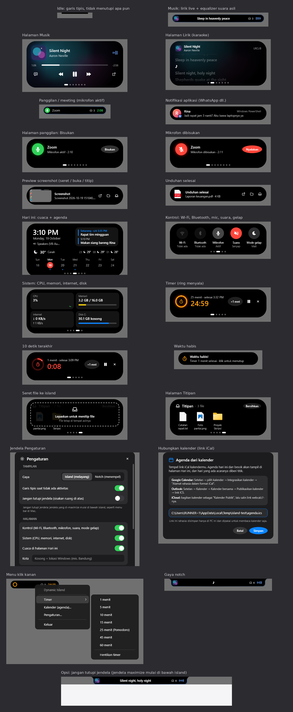

# Dynamic Island untuk Windows

Island / notch ala iPhone & MacBook di bagian atas layar Windows. Dibuat native (C# WPF, .NET 10)
supaya **ringan**: tidak ada Electron atau browser tersembunyi, tidak ada polling, dan tidak ada render
saat island diam.

<p align="center">
  
</p>

<sub>Tangkapan layar asli dari tes UI otomatis di GitHub Actions (Windows). Panel musik tidak ikut
karena mesin CI tidak memutar media.</sub>

## Fitur

- **Carousel**: island yang terbuka berisi halaman-halaman yang bisa digeser, dengan titik
  pagination ala iOS: 🎵 **Musik** (kalau ada media) → ⏱ **Timer** → 📅 **Hari ini** →
  📥 **Titipan** (kalau ada file). Geser dengan **Shift + scroll**, swipe dua jari ke samping di
  touchpad, klik-tarik (atau swipe di layar sentuh), atau klik titiknya. Halaman bisa "dilempar",
  memantul di ujung, halaman samping mengecil dan memudar, dan tinggi island ikut menyesuaikan.
- **Scroll untuk volume**: scroll di atas island (kecil maupun terbuka) untuk naik/turun volume
  2% per langkah; klik tengah (klik roda mouse) untuk mute. Saat island terbuka, bar volume kecil
  muncul di tempat titik pagination.
- **Titipan file (seperti NotchDrop)**: seret file atau folder ke island — island membuka area drop
  dengan garis putus-putus yang bergerak. File muncul sebagai thumbnail di halaman Titipan; seret
  keluar ke folder/aplikasi mana pun (ikon di judul = bawa semua sekaligus), klik untuk membuka,
  × untuk melepas. Yang disimpan hanya lokasinya (tidak ada salinan), tetap ada setelah restart,
  dan badge kecil di island menunjukkan jumlahnya.
- **Now Playing**: Spotify, YouTube/Chrome/Edge, Media Player, dan semua aplikasi yang muncul di
  kontrol media Windows. Mode ringkas menampilkan cover album + equalizer yang warnanya diambil dari
  cover. Hover atau klik untuk membuka panel penuh: judul, artis, progress bar (bisa diklik untuk
  *seek*), serta tombol previous / play-pause / next.
- **Lagu baru**: notifikasi singkat berisi cover, judul, dan artis setiap kali lagu berganti.
- **Timer & Pomodoro**: mulai dari halaman Timer (5–45 menit) atau menu klik kanan (1–60 menit).
  Island ringkas menampilkan ring hitung mundur + sisa waktu (berdampingan dengan cover kalau musik
  jalan). Di halaman Timer ada pause, +1 menit, dan stop. Saat waktu habis island berdenyut dan
  berbunyi; klik untuk menutup.
- **Indikator mikrofon & kamera**: titik oranye (mikrofon) dan hijau (kamera) seperti iPhone,
  plus notifikasi berisi nama aplikasi yang memakainya (Zoom, Discord, Chrome, dll.).
- **Ganti perangkat audio**: notifikasi saat output pindah, misalnya earbuds Bluetooth tersambung,
  lengkap dengan nama perangkat dan ikon headphone/speaker.
- **Volume**: indikator volume & mute saat volume diubah (tombol keyboard, tray, atau aplikasi).
- **Baterai**: "Mengisi daya" saat charger dicolok, "Menggunakan baterai" saat dicabut,
  "Baterai lemah" ketika baterai turun ke 20% dan 10%, serta status penghemat baterai (kuning).
- **Hari ini**: jam, tanggal, kalender minggu ini (hari ini dilingkari), baterai, dan perangkat
  audio yang sedang dipakai.
- **Dua gaya**: *Island* (pil melayang) atau *Notch* (menempel di tepi atas dengan lekukan seperti
  MacBook).
- **Otomatis sembunyi** saat ada aplikasi fullscreen (game, video, presentasi).
- Animasi pegas (*spring*) dengan sedikit pantulan seperti aslinya, tajam di semua skala DPI.
- Tidak mencuri fokus saat diklik dan tidak muncul di taskbar maupun Alt+Tab.

Klik kanan island untuk menu: **Timer**, gaya island/notch, **Notifikasi** (volume, lagu baru,
perangkat audio, mikrofon & kamera — masing-masing bisa dimatikan), jalankan saat Windows mulai,
dan keluar.

## Kenapa ringan

| Bagian | Cara kerjanya |
| --- | --- |
| Animasi bentuk | Simulasi pegas yang hanya terhubung ke render loop **selama bergerak**, lalu lepas lagi |
| Equalizer | 30 fps, dan hanya saat musik diputar **dan** terlihat di layar |
| Media | Event dari `GlobalSystemMediaTransportControls`, tanpa polling |
| Volume | Callback Core Audio (`IAudioEndpointVolumeCallback`), tanpa polling |
| Baterai | Pesan `WM_POWERBROADCAST` dari Windows, tanpa polling |
| Fullscreen | Notifikasi AppBar `ABN_FULLSCREENAPP` dari shell, tanpa polling |
| Mikrofon & kamera | Notifikasi perubahan registry (`RegNotifyChangeKeyValue`), tanpa polling |
| Timer / Pomodoro | Satu alarm sekali-jalan di akhir hitungan; tampilan hanya di-update selama terlihat |
| Update tampilan | Hanya untuk halaman yang sedang terlihat (jam, progress lagu, hitung mundur) |
| Carousel | Pegas yang hanya terhubung ke render loop selama halaman bergeser |
| Titipan file | Hanya path yang disimpan; thumbnail diambil sekali dari Explorer saat tampil |

Saat idle aplikasi tidak menjalankan timer dan tidak merender apa pun. Pemakaian RAM-nya setara
aplikasi WPF kecil pada umumnya (jauh di bawah aplikasi berbasis Electron).

## Kebutuhan

- Windows 10 versi 2004 (build 19041) atau lebih baru, atau Windows 11
- [.NET Desktop Runtime 10](https://dotnet.microsoft.com/download/dotnet/10.0) untuk menjalankan,
  atau .NET SDK 10 untuk build sendiri

## Cara menjalankan

### Opsi 1: unduh dari GitHub Actions

Setiap push otomatis di-build dan dites di Windows. Buka tab **Actions**, pilih run terakhir, lalu
unduh artifact **DynamicIsland-win-x64**. Isinya satu file `DynamicIsland.exe`, langsung jalankan.
Artifact **screenshots** berisi tangkapan layar setiap tampilan dari tes UI otomatis.

### Opsi 2: build sendiri

```powershell
git clone <repo-ini>
cd dynamic-island
dotnet run --project src/DynamicIsland
```

Atau buka `DynamicIsland.sln` di Visual Studio 2022/2026 lalu tekan F5.

### Membuat file .exe

```powershell
# Satu file .exe kecil (perlu .NET Desktop Runtime 10 terpasang)
dotnet publish src/DynamicIsland -c Release -r win-x64 -p:SelfContained=false -p:PublishSingleFile=true -p:PublishReadyToRun=true -o publish

# Atau versi mandiri yang tidak perlu install runtime (ukuran file jauh lebih besar)
dotnet publish src/DynamicIsland -c Release -r win-x64 -p:SelfContained=true -p:PublishSingleFile=true -p:EnableCompressionInSingleFile=true -o publish
```

Untuk laptop ARM (Snapdragon), ganti `win-x64` dengan `win-arm64`.

## Struktur kode

```
src/DynamicIsland/
├─ IslandWindow.xaml(.cs)   Tampilan island, state machine, dan carousel halaman
├─ Theme.xaml               Warna, ikon vektor, gaya tombol & menu klik kanan
├─ Animation/
│  ├─ Spring.cs             Fisika pegas (response + damping ratio, seperti SwiftUI)
│  ├─ SpringValue.cs        Satu nilai berpegas (posisi carousel)
│  └─ IslandAnimator.cs     Morph lebar, tinggi, dan sudut island
├─ Controls/
│  ├─ EqualizerBars.cs      Animasi gelombang "now playing"
│  ├─ ProgressRing.cs       Ring hitung mundur timer
│  └─ BatteryIcon.cs        Ikon baterai ala iOS
├─ Services/
│  ├─ MediaService.cs       Sesi media sistem (judul, cover, kontrol, timeline)
│  ├─ ArtPalette.cs         Mengambil warna aksen dari cover album
│  ├─ VolumeService.cs      Perubahan volume dari Core Audio
│  ├─ PowerMonitor.cs       Status baterai, charger & penghemat baterai
│  ├─ PrivacyMonitor.cs     Aplikasi yang sedang memakai mikrofon / kamera
│  ├─ TimerService.cs       Timer & Pomodoro
│  ├─ ShelfService.cs       Daftar file titipan (shelf.json)
│  └─ ShellHooks.cs         Notifikasi fullscreen, daya, dan perubahan layar
├─ Interop/                 Deklarasi Win32, Core Audio & thumbnail Explorer
└─ AppSettings.cs           Pengaturan (%AppData%\DynamicIsland\settings.json) & autostart
tools/ui-smoke-test.ps1     Tes UI otomatis di CI (menjalankan app, klik-klik, ambil screenshot)
```

### Kustomisasi cepat

- **Ukuran tiap mode**: `SizeOf()` di `IslandWindow.xaml.cs`.
- **Rasa animasi**: `response` dan `damping` di `IslandAnimator.AnimateTo()`. Damping lebih kecil
  berarti pantulan lebih banyak.
- **Warna & ikon**: `Theme.xaml`.
- **Lama notifikasi**: argumen `TimeSpan` pada setiap pemanggilan `ShowActivity(...)`.

## Batasan

- Island hanya tampil di monitor utama.
- Popup volume bawaan Windows tetap muncul bersamaan dengan indikator di island.
- Indikator mikrofon/kamera membaca catatan privasi Windows, jadi aplikasi yang izinnya dimatikan
  di Settings → Privacy tidak akan terdeteksi (karena memang tidak bisa memakai perangkatnya).
- Notifikasi aplikasi (WhatsApp, email, dll.) belum didukung, karena API pembacanya mengharuskan
  aplikasi dipaketkan sebagai MSIX.
- Log error (kalau ada) tersimpan di `%AppData%\DynamicIsland\error.log`.
